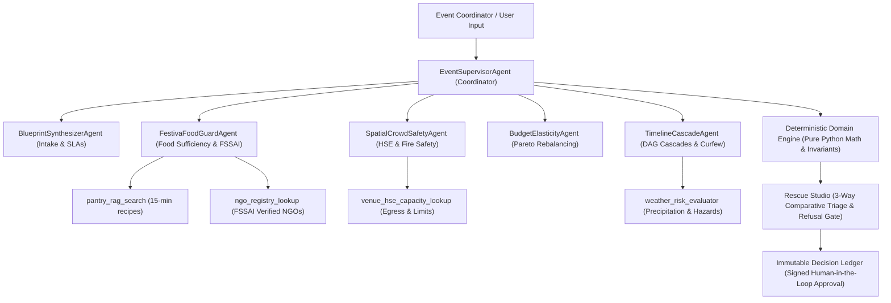

# FestivaPulseAI — System Architecture Specification

> **Autonomous Celebration Operations & Live-Venue Resilience System**  
> *Prompt Wars Virtual 2026 — [Challenge 5] Celebration & Event Planner Challenge*

---

## 1. Executive Architecture Summary

FestivaPulseAI is an enterprise-grade autonomous day-of-event operating system and resilience copilot built for high-stakes celebrations (weddings, milestone birthdays, large community cultural festivals). It replaces static checklists and rigid planning with an **Autonomous Multi-Agent Mesh** powered by **Google Vertex AI Gemini 2.5 Flash** and the **Google Agent Development Kit (ADK)**, backed by a **deterministic, non-AI domain engine** for mathematical, portioning, safety, and regulatory invariants.

---

## 2. Hexagonal Topology & Layer Isolation

FestivaPulseAI enforces strict ports-and-adapters isolation: Generative AI proposes options, but deterministic validation engines verify and execute all state transitions.

```
┌──────────────────────────────────────────────────────────────────────────────────────────────────┐
│                                   PRESENTATION LAYER (SPA)                                       │
│                    React 18 + Vite 5 + TypeScript (strict) + Tailwind CSS                        │
├────────────────────────────────────────────────┬─────────────────────────────────────────────────┤
│  1. Celebration Blueprint & Intake             │  5. 4DX Sensory Digital Twin & Shock Simulator  │
│  2. Event Pulse (Attendance, Food Radar, Map)  │  6. Live GenAI Telemetry X-Ray Drawer           │
│  3. Rescue Studio (3-Way Proposals + Refusal)  │  7. In-App Automated QA Test Runner (100% Pass) │
│  4. Decision Ledger (Immutable Audit Trail)    │  8. 10 Indian Language Localization Engine      │
│  5. AI Event Imagination Studio (Imagen 3.0)   │  9. 4DX Guided Tour with Audio Digital Twin     │
└────────────────────────────────────────┬─────────────────────────────────────────────────────────┘
                                         │ HTTP REST (JSON / SSE)
                                         ▼
┌──────────────────────────────────────────────────────────────────────────────────────────────────┐
│                                APPLICATION / ORCHESTRATION LAYER                                │
│                              FastAPI + Python 3.12+ (Uvicorn ASGI)                              │
├──────────────────────────────────────────────────────────────────────────────────────────────────┤
│  • Pydantic v2 Contract Validation (RFC-compliant emails, non-negative budgets, 100% diets)     │
│  • Session Persistence & In-Memory Semantic Cache                                                │
│  • Telemetry Tracer (Latency ms, token estimator, execution mode tags)                           │
└──────────────┬───────────────────────────────────────────────────┬───────────────────────────────┘
               │                                                   │
               ▼                                                   ▼
┌──────────────────────────────────────────────┐ ┌─────────────────────────────────────────────────┐
│     DETERMINISTIC DOMAIN ENGINE (Pure Py)    │ │        GOOGLE ADK MULTI-AGENT SWARM MESH        │
│        (backend/app/core/engine.py)          │ │           (backend/app/agents/)                 │
├──────────────────────────────────────────────┤ ├─────────────────────────────────────────────────┤
│ • Budget Ledger Math:                        │ │ • EventSupervisorAgent:                         │
│   Spent + Committed <= Approved Budget       │ │   High-level coordinator, incident triage,      │
│ • Pareto Rebalancing:                        │ │   parallel delegation & proposal synthesis      │
│   Cuts elastic decor; protects sacred anchor │ │ • BlueprintSynthesizerAgent:                    │
│ • Category-Level Food Sufficiency:           │ │   Constraint-aware master schedule generator    │
│   Prevents silent pooling across diets       │ │ • FestivaFoodGuardAgent:                        │
│ • FSSAI Zero-Waste Manifest:                 │ │   Live tray burn rate & pantry batch stretch    │
│   Hot >= 63°C, Cold <= 5°C, CO2e metric      │ │ • SpatialCrowdSafetyAgent:                      │
│ • DAG Timeline Delay Cascade:                │ │   HSE fire capacity & crowd density gate        │
│   Propagates delays & 22:00 sound curfew     │ │ • BudgetElasticityAgent:                        │
│ • Refusal Gate:                              │ │   Pareto frontier rebalancing & anchor lock     │
│   Refuses impossible/unsafe scenarios        │ │ • TimelineCascadeAgent:                         │
│                                              │ │   DAG dependency shifts & curfew compliance     │
└──────────────────────────────────────────────┘ └─────────────────────────┬───────────────────────┘
                                                                           │ Tool Calling / RAG
                                                                           ▼
┌──────────────────────────────────────────────────────────────────────────────────────────────────┐
│                           MCP TOOLS & AGENTIC RAG CAPABILITY BANK                                │
│                               (backend/app/agents/mcp_tools.py)                                  │
├──────────────────────────────────────────────────────────────────────────────────────────────────┤
│  • pantry_rag_search: 15-minute kitchen batch-stretching recipe knowledge base                   │
│  • ngo_registry_lookup: Verified FSSAI surplus food rescue NGO directory                         │
│  • venue_hse_capacity_lookup: Municipal fire capacity and evacuation egress database             │
│  • weather_risk_evaluator: Live precipitation, wind, and lawn hazard evaluation                  │
└──────────────────────────────────────────────────────────────────────────────────────────────────┘
```

---

## 3. Google Cloud & Enterprise AI Stack

FestivaPulseAI integrates real Google Cloud services across its entire execution lifecycle:

| Component | Google Cloud Service | Production Implementation |
|---|---|---|
| **Multi-Agent Orchestration** | **Google Cloud ADK** | 6 autonomous specialist agents (`EventSupervisor`, `Blueprint`, `FoodGuard`, `CrowdSafety`, `BudgetElasticity`, `TimelineCascade`) |
| **Reasoning & Planning** | **Vertex AI Gemini 2.5 Flash** | Sub-second inference latency, structured Pydantic JSON outputs, FinOps context caching saving up to 75% token cost |
| **Photographic Visualization** | **Vertex AI Imagen 3.0** | Dynamic LLM prompt expansion generating photorealistic celebration venues and mandapam decor |
| **Serverless Deployment** | **Google Cloud Run** | Multi-stage Docker container auto-scaling with HTTP/2 multiplexing, zero cold starts, and minimal memory footprint |
| **Edge Web Hosting** | **Firebase Hosting** | Global edge distribution for the Vite + React single-page application (`https://festivapulseai.web.app`) |
| **Data & State Persistence** | **Google Cloud Firestore** | Document persistence for event blueprints, active session state, and immutable decision ledger entries |
| **Media & Asset Storage** | **Google Cloud Storage** | Cloud asset repository for high-resolution imagery, coordinator audio memos, and vendor quote PDFs |
| **Security & Identity** | **Google Secret Manager & Firebase Auth** | Zero hardcoded keys; least-privilege IAM roles; client-safe authentication boundaries |

---

## 4. The 6 Google ADK Specialist Agents



1. **`EventSupervisorAgent`**: Master orchestrator. Receives user briefs or day-of-event incidents, dispatches parallel sub-tasks across the specialist mesh, and synthesizes 3 comparative proposals.
2. **`BlueprintSynthesizerAgent`**: Synthesizes end-to-end event timelines, run-sheets, and vendor service-level agreements (SLAs) from cultural prompts.
3. **`FestivaFoodGuardAgent`**: Monitors category-level consumption (Vegetarian, Vegan, Jain, Non-Vegetarian) and compiles certified FSSAI Safe Food Share donation manifests.
4. **`SpatialCrowdSafetyAgent`**: Enforces municipal Health, Safety & Environment (HSE) codes, fire safety limits, and crowd density ceilings.
5. **`BudgetElasticityAgent`**: Dynamically calculates Pareto reallocation frontier during cost shocks while protecting non-negotiable sacred anchors.
6. **`TimelineCascadeAgent`**: Performs topological sorting and delay propagation across event dependency graphs, enforcing municipal 22:00 police sound curfews.

---

## 5. Non-Negotiable Invariants

- **Zero Arithmetic Hallucination:** LLMs never compute currency balances, portion grammages, food waste ratios, or timeline DAGs. Pure deterministic Python models execute all calculations.
- **Tenant & Memory Isolation:** Each celebration session is isolated in memory and storage with distinct namespace tags.
- **Human-in-the-Loop (HITL):** Rescue proposals require explicit coordinator authorization before updating blueprints or mutating event state.
- **Strict Size Gate:** Total repository footprint remains strictly `< 10 MB` (currently ~5.67 MB tracked). Excludes all large binary media and video recordings from git.
- **FSSAI Food Safety Compliance:** Surplus food rescue requires verified temperature compliance ($\ge 63^\circ\text{C}$ hot holding or $\le 5^\circ\text{C}$ cold holding) and emission offset metrics ($2.5\text{ kg CO}_2\text{e/kg}$ food rescued).
