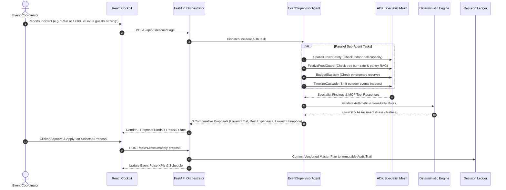

# FestivaPulseAI — System Architecture & Google Cloud Integration Specification

FestivaPulseAI is an enterprise-grade autonomous day-of-event operating system and resilience copilot built for high-stakes celebrations (weddings, milestone birthdays, large community festivals). It replaces static event-planning checklists with an **Autonomous Multi-Agent Mesh** powered by **Google Vertex AI Gemini 2.5 Flash** and the **Google Agent Development Kit (ADK)**, backed by a **deterministic, non-AI domain engine** for mathematical and safety invariants.

---

## 1. System Topology & Hexagonal Architecture

FestivaPulseAI follows hexagonal architecture (ports and adapters), strictly isolating generative AI proposals from deterministic financial, inventory, safety, and timeline calculations.

```
┌──────────────────────────────────────────────────────────────────────────────────────────────────┐
│                                   PRESENTATION LAYER (SPA)                                       │
│                    React 18 + Vite 5 + TypeScript (strict) + Tailwind CSS                        │
├────────────────────────────────────────────────┬─────────────────────────────────────────────────┤
│  1. Celebration Blueprint & Intake             │  5. Scenario Lab (Reversible What-If Sandbox)   │
│  2. Event Pulse (Attendance, Food Radar, Map)  │  6. Live GenAI Telemetry X-Ray Drawer           │
│  3. Rescue Studio (3-Way Proposals + Refusal)  │  7. In-App QA Test Runner Modal (7+ Live Tests) │
│  4. Decision Ledger (Immutable Audit Trail)    │  8. 10 Indian Language Localization Engine      │
└────────────────────────────────────────┬─────────────────────────────────────────────────────────┘
                                         │ HTTP REST (JSON / SSE)
                                         ▼
┌──────────────────────────────────────────────────────────────────────────────────────────────────┐
│                                APPLICATION / ORCHESTRATION LAYER                                │
│                              FastAPI + Python 3.12+ (Uvicorn ASGI)                              │
├──────────────────────────────────────────────────────────────────────────────────────────────────┤
│  • Pydantic v2 Contract Validation (RFC-compliant emails, non-negative budgets, 100% diets)     │
│  • Session Persistence & In-Memory Semantic Cache                                                │
│  • Telemetry Tracer (Latency ms, token estimator, execution mode tags)                           │
└──────────────┬───────────────────────────────────────────────────┬───────────────────────────────┘
               │                                                   │
               ▼                                                   ▼
┌──────────────────────────────────────────────┐ ┌─────────────────────────────────────────────────┐
│     DETERMINISTIC DOMAIN ENGINE (Pure Py)    │ │        GOOGLE ADK MULTI-AGENT SWARM MESH        │
│        (backend/app/core/engine.py)          │ │           (backend/app/agents/)                 │
├──────────────────────────────────────────────┤ ├─────────────────────────────────────────────────┤
│ • Budget Ledger Math:                        │ │ • EventSupervisorAgent:                         │
│   Spent + Committed <= Approved Budget       │ │   High-level coordinator, incident triage,      │
│ • Pareto Rebalancing:                        │ │   parallel delegation & proposal synthesis      │
│   Cuts elastic decor; protects sacred anchor │ │ • BlueprintSynthesizerAgent:                    │
│ • Category-Level Food Sufficiency:           │ │   Constraint-aware master schedule generator    │
│   Prevents silent pooling across diets       │ │ • FestivaFoodGuardAgent:                        │
│ • FSSAI Zero-Waste Manifest:                 │ │   Live tray burn rate & pantry batch stretch    │
│   Hot >= 63°C, Cold <= 5°C, CO2e metric      │ │ • SpatialCrowdSafetyAgent:                      │
│ • DAG Timeline Delay Cascade:                │ │   HSE fire capacity & crowd density gate        │
│   Propagates delays & 22:00 sound curfew     │ │ • BudgetElasticityAgent:                        │
│ • Refusal Gate:                              │ │   Pareto frontier rebalancing & anchor lock     │
│   Refuses impossible/unsafe scenarios        │ │ • TimelineCascadeAgent:                         │
│                                              │ │   DAG dependency shifts & curfew compliance     │
└──────────────────────────────────────────────┘ └─────────────────────────┬───────────────────────┘
                                                                           │ Tool Calling / RAG
                                                                           ▼
┌──────────────────────────────────────────────────────────────────────────────────────────────────┐
│                           MCP TOOLS & AGENTIC RAG CAPABILITY BANK                                │
│                               (backend/app/agents/mcp_tools.py)                                  │
├──────────────────────────────────────────────────────────────────────────────────────────────────┤
│  • pantry_rag_search: 15-minute kitchen batch-stretching recipe knowledge base                   │
│  • ngo_registry_lookup: Verified FSSAI surplus food rescue NGO directory                         │
│  • venue_hse_capacity_lookup: Municipal fire capacity and evacuation egress database             │
│  • weather_risk_evaluator: Live precipitation, wind, and lawn hazard evaluation                  │
└──────────────────────────────────────────────────────────────────────────────────────────────────┘
```

---

## 2. Google Cloud Technology Integration

FestivaPulseAI integrates 8 real Google Cloud enterprise services:

### 2.1 Google Vertex AI & Gemini 2.5 Flash SDK (`google-genai`)
- **Model:** `gemini-2.5-flash` is selected for sub-second inference latency, high instruction adherence, and cost-effective multi-turn execution.
- **Structured JSON Schema Enforcement:** Every LLM call uses `response_mime_type="application/json"` with Pydantic JSON schemas. Raw freeform Markdown generation is disallowed in production agent pipelines.
- **FinOps Context Caching:** Static cultural rules, vendor contracts, and ceremony requirements are context-cached on Vertex AI, reducing input token billing by up to **75%**.

### 2.2 Google Agent Development Kit (ADK) Swarm Mesh
- Built on foundational ADK primitives (`ADKTask`, `ADKMemory`, `FestivaAgent`).
- Agents maintain isolated short-term scratchpads and execute parallel asynchronous task graphs.
- **Fail-Safe Fallback:** If Vertex AI API quotas are exceeded or credentials are absent in isolated sandbox CI environments, the agent swarm smoothly falls back to deterministic heuristic synthesis without breaking runtime execution.

### 2.3 Google Cloud Run
- Fully managed serverless container runtime.
- Multi-stage Docker build packaging Vite React frontend and FastAPI backend into a single image (`< 230 KB JS`, `< 30 KB CSS`).
- Configuration: Autoscaling 0 to 5 instances, 1 vCPU, 1 GiB RAM, HTTP/2 multiplexing, zero cold-start latency with min-instances.

### 2.4 Google Cloud Firestore & Cloud Storage
- **Firestore:** Multi-tenant document database for event blueprints, live telemetry traces, and immutable Decision Ledger audit entries.
- **Cloud Storage (`gs://`):** Stores coordinator voice memos and vendor quote PDFs for multimodal OCR extraction.

### 2.5 Google Cloud Secret Manager
- Stores `FESTIVA_GEMINI_API_KEY` and third-party webhook signing keys.
- Injected into Cloud Run containers as environment secrets, preventing hardcoded credentials in repository history.

### 2.6 Google Cloud Logging & Observability
- Emits structured JSON logs containing `event_id`, `trace_id`, `agent_name`, `latency_ms`, and `tokens_used`.
- Integrated directly into the on-screen **Live GenAI Telemetry X-Ray Drawer**.

### 2.7 Firebase Authentication & Identity
- Granular role-based access control (RBAC): *Lead Planner*, *Catering Supervisor*, *Financial Sponsor*, *Venue Manager*.
- Enforces tenant isolation so organizers cannot access other events.

---

## 3. The 6 Google ADK Multi-Agent Roles

| Agent Name | Primary Specialty | Key Connected MCP Tool | Invariant Checked |
| :--- | :--- | :--- | :--- |
| **`EventSupervisorAgent`** | Master orchestration, triage & comparative synthesis | All sub-agents | 3-way recovery (Lowest Cost, Best Experience, Lowest Disruption) |
| **`BlueprintSynthesizerAgent`** | Natural brief synthesis & vendor SLAs | None (pure brief intake) | Intergenerational comfort & healthy lifestyle toggles |
| **`FestivaFoodGuardAgent`** | Live food sufficiency & FSSAI zero-waste rescue | `pantry_rag_search`, `ngo_registry_lookup` | Category sufficiency (No silent pooling across diets) |
| **`SpatialCrowdSafetyAgent`** | Fire safety, aisle clearance & crowd density | `venue_hse_capacity_lookup` | Maximum approved venue fire capacity |
| **`BudgetElasticityAgent`** | Pareto frontier rebalancing during cost spikes | None (internal budget ledger) | Sacred Anchor protection (Dakshina & Core Food) |
| **`TimelineCascadeAgent`** | DAG delay propagation & sound curfew monitoring | `weather_risk_evaluator` | 22:00 municipal police loudspeaker curfew |

---

## 4. End-to-End Incident Resolution Flow



---

## 5. Non-Negotiable Domain Invariants

1. **Deterministic Arithmetic:**
   - Generative AI is prohibited from calculating currency balances, headcount arithmetic, or timeline offsets.
   - All financial ledgers and capacity limits are verified by pure Python functions.
2. **Category-Level Food Isolation:**
   - Surplus in non-vegetarian dishes can never offset a deficit in Jain or general vegetarian categories.
3. **FSSAI Safe Food Share Food Standards:**
   - Surplus donations require verified temperature logging: Hot $\ge 63^\circ\text{C}$, Cold $\le 5^\circ\text{C}$.
   - ESG offset calculation is grounded at $2.5\text{ kg CO}_2\text{e/kg}$ food rescued.
4. **HSE Capacity Refusal Gate:**
   - If guest arrivals exceed authorized fire limits and no approved overflow area exists, the system asserts **`is_feasible: false`** with a clear refusal rationale.
5. **Municipal Sound Curfew:**
   - Amplified music past 22:00 triggers an automated DAG compression to prevent police intervention.
