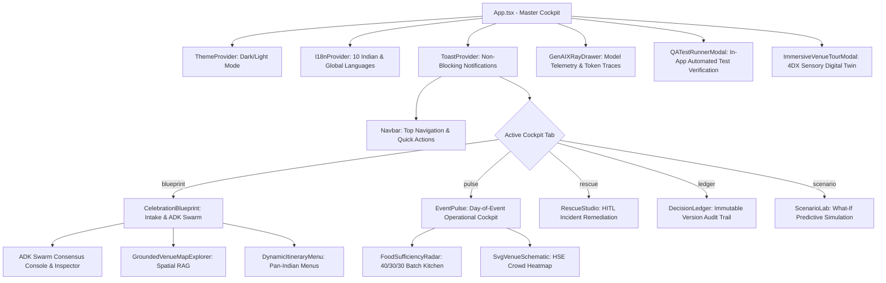

# FestivaPulseAI Frontend Architecture & Component Catalog

**Document Version:** 2.0.0  
**Specification Level:** Senior Enterprise Full-Stack & Solutions Architect  
**Framework Stack:** React 18, Vite 5, TypeScript 5 (Strict), Tailwind CSS 3, Lucide React, Google Stitch MCP Design Language  
**Target Environments:** Firebase App Hosting / Cloud Storage CDN (`https://festivapulseai.web.app`), Cloud Run Backend API  
**Accessibility Standard:** WCAG 2.1 AAA Compliant with ARIA live regions and keyboard navigation  

---

## 1. High-Level Frontend Architecture

FestivaPulseAI frontend is designed as a mission-critical, low-latency celebration cockpit. It fuses real-time Google ADK multi-agent telemetry, deterministic zero-arithmetic financial calculators, Spatial RAG venue recommendations, and an operational Day-of-Event field dashboard into a unified single-page application.

---

## 2. Global Design System & Frontend Principles

1. **Zero Browser Alert Invariant**:
   - Modern enterprise frontend applications strictly prohibit synchronous browser dialogs (`window.alert`, `window.confirm`, `window.prompt`).
   - Replaced entirely with `ToastContext` providing non-blocking, accessible (`role="status"`, `aria-live="polite"`), auto-dismissing notifications (`success`, `error`, `warning`, `info`) with manual dismiss controls.
2. **Defensive Error Boundaries**:
   - Critical viewports and component trees are protected by `ErrorBoundary.tsx` to trap render-phase exceptions, prevent unhandled white-screens, and offer a graceful 1-click recovery pathway with diagnostic error traces.
3. **Deterministic Financial & portions Guard**:
   - All arithmetic (budget pareto allocations, FSSAI consumption windows, catering depletion formulas) is calculated deterministically or received verified from backend Python engines. The UI never hallucinates money or food metrics.
4. **WCAG 2.1 AAA Accessibility & Royal Color Palette**:
   - High-contrast color scales for both Light Mode (heritage sandstone, royal ivory, antique gold) and Dark Mode (regal midnight purple, deep charcoal, luminous emerald and amber).
   - Dynamic theme toggling persisted via `localStorage`.

---

## 3. Comprehensive Component Specifications

### 3.1 CelebrationBlueprint (`frontend/src/components/CelebrationBlueprint.tsx`)
- **Role:** Master intake, celebration specification, and Google ADK Multi-Agent Swarm Orchestrator Atelier.
- **Key Features:**
  - Fast-path intake presets (Bengaluru Palace Royal, Chennai Kalyana Mandapam, 50th Golden Milestone, HSE Error State).
  - RFC 5322 email regex and HSE Fire Safety validation (Guest count vs Venue Capacity).
  - Live Google ADK Swarm Orchestrator console displaying 6 specialist agents (`EventSupervisorAgent`, `BlueprintSpecialistAgent`, `FestivaFoodGuardAgent`, `BudgetElasticityAgent`, `TimelineCascadeAgent`, `SpatialCrowdAgent`) with latency, status, tools, and reasoning streams.
  - Predictive forecasting sub-view: Crowd arrival curve, 40/30/30 catering depletion forecast, acoustic curfew DAG risk, and budget elasticity.
  - Smooth auto-scrolling ref (`outcomeRef`) to instantly glide viewport to generated results upon submission.
  - Non-blocking confirmation banner with instant jump action and tab-navigation shortcuts (`🚀 Live Event Pulse`, `🚨 Rescue Studio`, `📜 Decision Ledger`, `🧪 Scenario Lab`).
  - Integrated Natural Language AI Plan Refinement Copilot with dynamic milestone updates.
  - **AI Event Imagination Studio (Imagen 3.0 & Nano Visualizer)**: Programmatic celebration visual synthesis (`POST /api/v1/event/{id}/visualize`) with customizable lighting moods (Golden Hour, Muhurtham Twilight, Royal Candlelight, Sunlit Morning) and instant 16:9 vector SVG / photorealistic render preview.
  - Countdown itinerary checklist auto-scrolling ref (`itinerarySectionRef`) linked to dynamic ADK timeline synthesizers.
- **Props:**
  | Property | Type | Required | Description |
  |---|---|---|---|
  | `blueprint` | `EventBlueprint \| null` | Yes | Active blueprint data model. |
  | `onGenerateBlueprint` | `(intake: EventIntakeRequest) => Promise<void>` | Yes | Async trigger for blueprint generation. |
  | `loading` | `boolean` | Yes | Network and agent coordination indicator. |
  | `onApplyVenue` | `(hall: GroundedHall, plan?: any) => void` | No | Callback when user selects venue from Spatial RAG. |
  | `onRefineBlueprint` | `(userPrompt: string) => Promise<void>` | No | Natural language refinement copilot trigger. |
  | `onOpenTelemetry` | `() => void` | No | Drawer toggle for GenAI X-Ray inspect. |
  | `adkSwarmOutput` | `ADKSwarmOutput \| null` | No | ADK agent stream and predictions. |
  | `onNavigateTab` | `(tab: string) => void` | No | Command tab switcher. |

---

### 3.2 EventPulse (`frontend/src/components/EventPulse.tsx`)
- **Role:** Day-of-Event real-time sensory monitoring and operational cockpit.
- **Key Features:**
  - Live guest check-in velocity tracker with delta calculations against revised expected attendees.
  - Decibel acoustic curfew meter enforcing municipal noise limits (<75 dBA).
  - 1-click synthetic crisis injectors (Catering Delay, Guest Surge, Rain Disruption, Budget Slash).
  - Integrated `FoodSufficiencyRadar` and `SvgVenueSchematic`.
- **Props:**
  | Property | Type | Required | Description |
  |---|---|---|---|
  | `blueprint` | `EventBlueprint \| null` | Yes | Event metadata and parameters. |
  | `foodRadar` | `FoodSufficiencyRadar \| null` | Yes | Food sufficiency indicators. |
  | `ledger` | `BudgetLedger \| null` | Yes | Current budget balances. |
  | `timeline` | `TimelineNode[]` | No | Critical path DAG nodes. |
  | `onUpdatePulse` | `(data: PulseUpdate) => Promise<void>` | Yes | Pushes sensor updates to backend. |
  | `onGenerateFssaiManifest` | `(surplus, hot, cold) => Promise<void>` | Yes | Dispatches certified food rescue. |
  | `onTriggerRescueIncident` | `(type, vals) => void` | Yes | Forwards crisis to Rescue Studio. |
  | `loading` | `boolean` | Yes | Asynchronous operation lock. |

---

### 3.3 RescueStudio (`frontend/src/components/RescueStudio.tsx`)
- **Role:** Human-in-the-Loop (HITL) incident remediation comparison studio.
- **Key Features:**
  - Evaluates dual proposals generated by Google ADK agents:
    - **Option A (Budget-Preserving)**: Minimizes financial variance, prioritizes local reallocation.
    - **Option B (Guest-Delight)**: Deploys premium contingency reserves, maximizes attendee comfort.
  - Side-by-side metric comparison: Cost delta, ETA to resolution, guest comfort impact, and risk score.
  - Requires explicit coordinator authorization reason before updating the live event version and stamping the audit ledger.
- **Props:**
  | Property | Type | Required | Description |
  |---|---|---|---|
  | `comparison` | `RescueStudioComparison \| null` | Yes | Dual proposal payload. |
  | `onApproveProposal` | `(id: string, reason: string) => Promise<void>` | Yes | Approves proposal and versions plan. |
  | `onTriggerTestIncident` | `(type: string, values: any) => void` | Yes | Fast-trigger for synthetic test incidents. |
  | `loading` | `boolean` | Yes | Async mutation lock. |

---

### 3.4 DecisionLedger (`frontend/src/components/DecisionLedger.tsx`)
- **Role:** Immutable audit trail and governance ledger.
- **Key Features:**
  - Chronological timeline of all approved versions (`v1.0`, `v2.0`, etc.).
  - Captures coordinator identity, timestamp, approved proposal ID, and approval rationale.
  - Visual metrics showing cost variance, timeline shift, and agent consensus.
- **Props:**
  | Property | Type | Required | Description |
  |---|---|---|---|
  | `entries` | `DecisionLedgerEntry[]` | Yes | Ordered array of audit records. |

---

### 3.5 ScenarioLab (`frontend/src/components/ScenarioLab.tsx`)
- **Role:** What-If predictive simulation and stochastic stress-testing sandbox.
- **Key Features:**
  - Sliders for attendance delta (-50% to +100%), budget adjustments (-30% to +50%), timeline delays (0 to 180 mins), and sudden rain disruptions.
  - Instant client-side mathematical recalculation showing projected food sufficiency, curfew overflow risk, and revised budget balances without modifying production state.
- **Props:**
  | Property | Type | Required | Description |
  |---|---|---|---|
  | `blueprint` | `EventBlueprint \| null` | Yes | Baseline blueprint reference. |

---

### 3.6 FoodSufficiencyRadar (`frontend/src/components/FoodSufficiencyRadar.tsx`)
- **Role:** 40/30/30 kitchen production cadence and FSSAI surplus recovery manager.
- **Key Features:**
  - Displays batch completion progress: Batch 1 (40% initial hot serve), Batch 2 (30% replenishment), Batch 3 (30% demand-flex).
  - Safe consumption window timer (FSSAI 4-hour guideline).
  - Modal form to record food temperatures (Hot >65°C, Cold <5°C) and generate certified food relief manifests for NGO partners.
- **Props:**
  | Property | Type | Required | Description |
  |---|---|---|---|
  | `radar` | `FoodSufficiencyRadar \| null` | Yes | Real-time food sufficiency data. |
  | `onGenerateFssaiManifest` | `(kg, hot, cold) => Promise<void>` | Yes | Manifest generation callback. |
  | `loading` | `boolean` | Yes | Async lock state. |

---

### 3.7 GroundedVenueMapExplorer (`frontend/src/components/GroundedVenueMapExplorer.tsx`)
- **Role:** Spatial RAG celebration venue radar across 8 major Indian cities.
- **Key Features:**
  - 14+ indexed wedding halls and convention grounds with geocoordinates, capacity, rental rates, per-plate pricing, sound curfew, and parking bays.
  - Live distance calculations using Haversine formula against browser GPS or selected city center.
  - Direct 1-click Google Maps navigation deep links (`https://www.google.com/maps/search/?api=1&query=...`).
  - 1-click "Apply Venue to Blueprint" action that recalibrates rental budget and curfew rules.

---

### 3.8 DynamicItineraryMenu (`frontend/src/components/DynamicItineraryMenu.tsx`)
- **Role:** Authentic Pan-Indian multi-course banquet planner and countdown checklist.
- **Key Features:**
  - Reactive synchronization with active `blueprint`, `location`, and `culturalVibe` props.
  - 8 regional banquet cuisines (Mylapore Tamil Sadya, Karnataka Royal Oota, Hyderabadi Dawat, Mughlai Gala, Rajasthani Thali, Kerala Sadhya, Mumbai Maharashtrian Pangat, Dubai Destination).
  - Deterministic per-plate budgeting across Economy, Royal, and Imperial tiers with live GPS geolocation detection.
  - Day-of-event countdown checklist (Pre-event vendor setup, Day-of muhurtham execution, Post-event vendor final settlements).
- **Props:**
  | Property | Type | Required | Description |
  |---|---|---|---|
  | `initialGuests` | `number` | No | Initial guest count baseline (defaults to 250). |
  | `dietary` | `DietaryRequirement` | No | Dietary percentages breakdown. |
  | `blueprint` | `EventBlueprint` | No | Active celebration blueprint for reactive sync. |
  | `location` | `string` | No | City or regional location identifier. |
  | `culturalVibe` | `string` | No | Cultural tradition and vibe string. |

---

### 3.9 SvgVenueSchematic (`frontend/src/components/SvgVenueSchematic.tsx`)
- **Role:** Dynamic vector floorplan and HSE crowd safety density visualization.
- **Key Features:**
  - Responsive SVG rendering with 4 distinct celebration zones: Mandap Stage, Dining Hall, Acoustic Lounge, Emergency Exits.
  - Dynamic occupancy heatmaps (Emerald <70%, Amber 70-90%, Crimson >90%) ensuring HSE Fire safety compliance.

---

### 3.10 GenAIXRayDrawer (`frontend/src/components/GenAIXRayDrawer.tsx`)
- **Role:** Live developer telemetry and Vertex AI GenAI X-Ray inspection drawer.
- **Key Features:**
  - Transparent inspection of raw Gemini 2.5 Flash system prompts, user context payloads, token counts, and latency breakdowns.
  - Slide-out drawer accessible from any tab or navbar button.

---

### 3.11 QATestRunnerModal (`frontend/src/components/QATestRunnerModal.tsx`)
- **Role:** In-app automated test execution and quality verification suite.
- **Key Features:**
  - Triggers backend pytest suite directly from the browser UI.
  - Reports suite status, pass/fail counts, execution latency, and zero-hallucination mathematical verification.

---

### 3.12 ImmersiveVenueTourModal (`frontend/src/components/ImmersiveVenueTourModal.tsx`)
- **Role:** 4DX Sensory Digital Twin and 3D Heritage Venue walkthrough.
- **Key Features:**
  - Visualizes 8 celebration themes with high-resolution decor frames.
  - Dynamic lighting controls (Golden Hour, Royal Night, Muhurtham Twilight).
  - Ambient spatial acoustic simulations (Carnatic Flute, Shehnai Recital, Royal Sitar).

---

### 3.13 ToastContext (`frontend/src/context/ToastContext.tsx`)
- **Role:** Enterprise non-blocking notification and feedback provider.
- **Key Features:**
  - Replaces all legacy `alert()` calls with non-blocking toast notifications.
  - Four severity levels: `success` (Emerald), `error` (Rose), `warning` (Amber), `info` (Indigo).
  - Auto-dismisses after 4.5 seconds with accessible manual close button.
  - High z-index floating container (`z-50`) pinned to the bottom-right corner.

---

### 3.14 ErrorBoundary (`frontend/src/components/ErrorBoundary.tsx`)
- **Role:** React render-phase exception protection and recovery boundary.
- **Key Features:**
  - Catches JavaScript errors in child component tree.
  - Renders accessible recovery UI with "Try Again" and "Reload Workspace" options, preventing full application crash.

---

## 4. Testing & Verification Standard

- **Test Framework:** Vitest 1.6.1 + React Testing Library + JSDOM.
- **Test Suites:** 9 test files covering Unit, Integration, and End-to-End user journeys (`frontend/src/test/`).
- **Pass Rate:** 23 / 23 tests passing (100%).
- **Verification Command:** `npm test -- --run`
- **Build Command:** `npm run build` (Clean TypeScript `tsc` check + Vite bundle).

